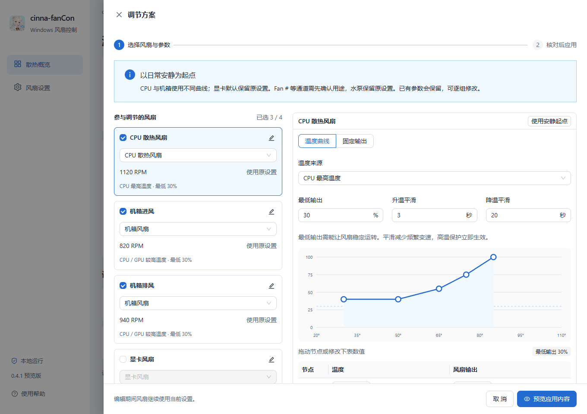

<h1 align="center">FanController</h1>

English · <a href="./README.zh-CN.md">简体中文</a>

A Windows application that adjusts supported CPU, case and GPU fans by temperature. Build a quiet-first control plan, review each fan’s settings, then apply it. Temperature curves and fixed output remain editable per fan group.

[Download the Windows installer](https://github.com/icelemon233/FanController/releases/download/v1.0.0/FanController-v1.0.0-windows-x64-setup.exe) · [Portable ZIP](https://github.com/icelemon233/FanController/releases/tag/v1.0.0) · [Build from source](./docs/build.md)

*Demo mode with simulated readings. The interface is currently in Simplified Chinese.*

## Use the app

1. Run the Windows installer. Creating a desktop shortcut and opening **FanController** after installation are selected by default; either option can be cleared.
2. Open **配置与预览** (Configure and preview). Confirm CPU and case fan roles against the actual wiring. Unidentified channels and pumps stay under their prior settings; GPU fans default to driver control.
3. Edit each selected fan’s source, minimum output, curve and response smoothing. Click **预览应用内容** (Review changes) to see every channel and exact parameter, then **应用方案** (Apply plan).

Editing and reviewing do not change hardware. The app does not acquire fans on startup. Unselected fans that were already controlled are restored when the plan is applied. The overview lists the fans actually under control, measured RPM, current output and applied parameters; expand a row for its full curve.

The editable quiet starting curves hold CPU fans at 40% through 50°C and case fans at 30% through 55°C, then rise to 100% at 85°C. Saved minimum outputs and custom settings are retained. CPU and case fans use different smoothing times to reduce brief speed changes. GPU driver control preserves idle fan-stop behaviour where supported.

Output percentages are control values, not RPM targets. There is no automatic RPM calibration. See [configuration and research notes (Chinese)](./docs/fan-configuration.md) for the exact curves, response times, protection rules and initial RPM guidance. Individual settings remain available under **风扇设置** (Fan settings).

Minimizing keeps the window in the taskbar and fans under control. Closing defaults to the tray; **设置** (Settings) at the bottom of the sidebar can change this to exit. Double-click the tray icon to reopen the window. Choose **恢复原设置并退出** (Restore prior settings and exit) in Settings or the tray menu to quit. Settings offers light, dark and system themes. New installations follow Windows; existing preferences are preserved. Closing an editor or exiting with unapplied changes asks whether to discard them.

The installer sets up the app for the current user and adds an entry in Windows Installed apps. During an interactive update, confirm the close prompt and setup will close the existing app normally, wait for fan restoration and the worker to exit, then continue. If shutdown fails, setup stops before changing program files. Silent installation and uninstall still require the app to be closed first. Uninstall removes packaged files and shortcuts; saved fan profiles remain. The installer is currently unsigned.

For the portable edition, extract the complete ZIP and open `FanController.exe`.

## Hardware and requirements

- Windows 10/11 x64 and [.NET Framework 4.8](https://dotnet.microsoft.com/en-us/download/dotnet-framework/net48).
- [Microsoft Edge WebView2 Runtime](https://developer.microsoft.com/microsoft-edge/webview2/). The installer detects it and runs Microsoft's bootstrapper if it is missing; that step requires an internet connection.
- A supported motherboard or GPU with a driver-exposed control interface.

For CPU temperature and motherboard fan access, click **启用主板访问** (Enable motherboard access). The app uses [LibreHardwareMonitor](https://github.com/LibreHardwareMonitor/LibreHardwareMonitor) and [PawnIO](https://pawnio.eu/). When PawnIO is missing, setup downloads its signed installer from the official release and checks its SHA-256. Complete the installer and Windows authorization prompts; the app then reconnects to the fan worker and detects supported interfaces.

AMD GPU monitoring and control use the installed driver's [ADLX interface](https://github.com/GPUOpen-LibrariesAndSDKs/ADLX). Legacy AMD ADL monitoring is disabled because its frame-metric polling can crash the worker. NVIDIA interfaces are detected through LibreHardwareMonitor on systems without AMD GPUs. On mixed AMD/other-GPU systems, this version monitors AMD GPUs only; CPU and motherboard monitoring remain available. Available controls depend on the hardware and driver. Dedicated USB fan controllers and Intel GPU fan control have not been validated.

If readings stop, **重新连接** (Reconnect) checks the worker, waits for a normal exit before any required restart, and waits for fresh readings. Progress and failure reasons remain visible. Saved profiles are retained, and settings are not reapplied automatically. After an unexpected worker exit, verify fan behaviour before applying settings; restoration before the crash cannot be confirmed.

This preview has automated tests for simulated fan control and desktop interaction. Fan-speed writes on physical hardware have not yet been validated. Fans connected to one control interface cannot be adjusted separately. Check your hardware's PWM/DC mode and RPM feedback before use.

For fans already controlled by the app, high temperatures or missing required readings request maximum output. When you exit, the app tries to restore prior settings. If restoration fails, it stays open. The worker also attempts restoration if its connection to the app is lost. Killing the worker, driver failures or power loss can prevent restoration. Avoid running multiple controllers on the same fans.

## Development

The interface uses React and Ant Design in WebView2. A separate C# worker accesses the hardware. Frontend assets are bundled with the app; normal fan control does not need an internet connection.

See [build and test instructions](./docs/build.md) for source layout, profile storage and migration from the previous application name. Dependency caches, build outputs, saved profiles and local hardware reports are excluded from Git.

The [frontend architecture](./docs/frontend-architecture.md) describes module boundaries, native data validation, editor state and checks. The [design notes](./docs/design.md) describe the interface and visual checks.

Third-party components retain their own licenses; see [third-party notices](./third-party/THIRD-PARTY-COMPONENTS.txt). The project's own code does not yet have a license.

Developer: Cinna.
