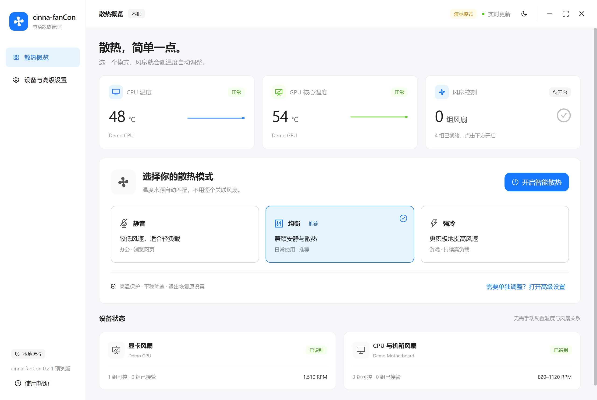

# cinna-fanCon

[English](./README.md) | 简体中文

用于控制受支持的 CPU、机箱和显卡风扇的 Windows 桌面应用。可以选择静音、均衡、强冷模式，也可以为单组风扇设置固定输出或温度曲线。

[下载 Windows 预览版](https://github.com/icelemon233/cinna-fanCon/releases/tag/v0.2.1) · [从源码构建](./docs/build.md)

*截图来自应用的演示模式，使用合成数据。目前软件界面为简体中文。*

## 使用

1. 下载并完整解压 Windows 压缩包，打开 `cinna-fanCon.exe`。
2. 选择“静音／均衡／强冷”，点击“开启智能散热”。
3. 开启后直接切换模式；点击“恢复原设置”停止接管风扇。

CPU 风扇自动跟随 CPU 温度，显卡风扇跟随 GPU 核心温度。机箱风扇在 CPU、GPU 温度都可用时取二者更高值，否则使用 CPU 温度。必要温度缺失、被排除的风扇和已识别的水泵会跳过。

高级设置提供单组曲线、固定输出、最低输出和转速反馈。切换模式会保留已设置的较高最低输出，也可以将某组风扇排除在自动控制之外。应用支持深浅色主题、实时温度与 RPM，以及托盘运行。

## 硬件与运行环境

- Windows 10/11 x64、.NET Framework 4.8。
- [Microsoft Edge WebView2 Runtime](https://developer.microsoft.com/microsoft-edge/webview2/)。
- 主板或显卡驱动需提供受支持的风扇控制接口。

主板访问通过 [LibreHardwareMonitor](https://github.com/LibreHardwareMonitor/LibreHardwareMonitor) 和 [PawnIO](https://pawnio.eu/) 完成。点击“启用主板支持”后，应用按需从官方发布地址下载签名安装器、检查 SHA-256，再为独立风扇服务申请 Windows 授权。界面会保持打开。

AMD 显卡通过已安装驱动的 [ADLX 接口](https://github.com/GPUOpen-LibrariesAndSDKs/ADLX) 访问；NVIDIA 接口由 LibreHardwareMonitor 枚举。实际支持取决于硬件和驱动。专用 USB 风扇控制器及 Intel 显卡调速不属于已验证范围。

当前为预览版。自动测试覆盖模拟风扇控制与桌面交互链路，尚未完成真实硬件的调速写入验证。多个物理风扇可能共用一个接口，请核对硬件的 PWM/DC 模式与转速反馈。

已接管风扇在高温或必要温度读数不可用时请求最高输出。正常退出会尝试恢复原设置；强制结束风扇服务、驱动故障或断电可能导致无法恢复。请避免多个调速程序同时控制同一设备。

## 开发

界面使用 React、Ant Design 和 WebView2，硬件访问由独立 C# 服务完成。界面资源在本地打包。旧名称下的风扇配置可以读取，并在保存时写入新名称的目录。

构建与测试见[开发说明](./docs/build.md)。下载的依赖、构建输出、运行配置和私人硬件报告均不提交到 Git。

第三方组件保留各自许可证，见[依赖说明](./third-party/THIRD-PARTY-COMPONENTS.txt)。项目自身代码的许可证尚未指定。
