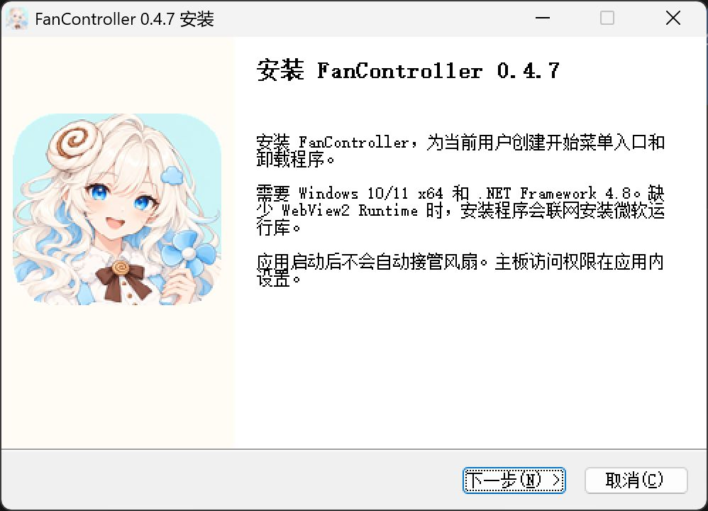

# FanController 0.4.7 安装器验证

日期：2026-10-24。版本：0.4.7 preview。

## 修改

- 保留 NSIS / Modern UI 2、现有安装范围、依赖检测、语言、快捷方式和资料保留流程。
- 从已确认的 `docs/brand/cinna-app-icon.png` 导出安装品牌资源。侧图为 164×314 RGB BMP，背景 `#FFFCF6`，图标为 148×148、位置 `(8,58)`、圆角 32；页头为 150×57，图标为 48×48、位置 `(98,4)`、圆角 11。资源来源、参数和 SHA-256 记录在 `installer/assets/brand.json`。
- 安装和卸载配置应用图标、侧图及右侧页头；窗口标题包含产品名和版本。欢迎页提供中文、英文标题，沿用原有说明。
- 组件页移除没有内容的描述区，让完整选项无需横向滚动即可阅读。
- 安装器识别 `FanController`、`FanController · 风扇控制`、`cinna-fanCon · 风扇控制` 和 `cinna-fanCon · 智能散热`。退出前仍核对程序路径，等待主程序和服务结束；没有增加强制结束操作。
- 增加编译时隔离的 QA 构建参数，独立存放程序、注册项、快捷方式和互斥锁。QA 入口只打开模拟应用，缺少共享运行库时停止；正式安装器不接受 QA 重定向参数。

## 检查结果

| 检查 | 结果 |
| --- | --- |
| 前端与应用构建 | 类型、lint、格式、40 项行为与对比度测试及生产构建通过；两个 C# 程序版本均为 0.4.7.0 |
| 核心与服务 | 8 组模拟核心测试、规划测试、5 种服务生命周期测试通过 |
| 品牌资源 | 母版哈希、导出文件哈希、24-bit RGB BMP、画布尺寸、图像边界与奶油色背景校验通过；重复生成结果稳定 |
| 升级退出 | Ready、Refuse、WrongPath、Silent、Idle、隐藏托盘窗口及三种旧标题场景通过；拒绝退出和路径不符时停止，未强杀模拟服务 |
| 正式安装器预览 | 实际打开最终向导，检查中文欢迎页和组件页，确认图标、版本、页头与完整选项；随后取消，没有安装到日常目录 |
| 隔离安装 | 中文欢迎、组件、进度、完成页检查通过；安装文件与应用构建哈希一致，注册项和快捷方式均在 QA 范围 |
| 隔离重复安装 | 英文欢迎、组件、进度、完成页检查通过；调用旧卸载器后完成重复安装，保留安装目录内的清单外测试文件；完成页启动选项可取消 |
| 隔离静默卸载 | 正常静默卸载退出码 0；清除清单文件、QA 快捷方式与注册项，保留清单外测试文件 |
| 日常环境保留 | 日常安装程序和风扇配置的 SHA-256 未变，既有主程序与服务进程 ID 保持不变 |
| Git | `git diff --check` 通过 |

## 截图

本地截图位于被 Git 忽略的 `artifacts/installer-ui`：

- `production-welcome-zh.png`、`production-components-zh.png`：正式安装器的欢迎页与组件页。
- `qa-progress-zh.png`、`qa-finish-zh.png`：隔离中文安装的进度页与完成页。
- `qa-welcome-en.png`、`qa-components-en.png`、`qa-upgrade-progress-en.png`、`qa-finish-en.png`：隔离英文重复安装。
- `qa-finish-launch-disabled-en.png`：取消自动打开选项。

本地生命周期检查结果位于 `artifacts/tests/installer-ui-qa.txt`。

## 未实测范围

- 电脑操作工具拒绝启动图形卸载器，返回 `product policy blocks this app`。卸载页品牌配置已编译，静默卸载已验证；图形卸载确认页和进度页没有实测。
- 真实窗口仅在当前 200% DPI 环境检查，其他 DPI 与跨屏缩放没有实测。
- 本次没有升级或卸载日常安装，没有访问真实风扇控制接口。缺少 WebView2 时的联网安装分支需要干净系统验证。
- 安装器尚未代码签名。GitHub 发布文件的校验值以 Release 中的 `.sha256` 和提交清单为准。
